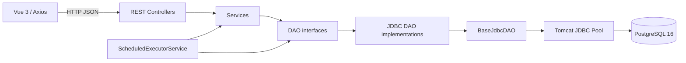
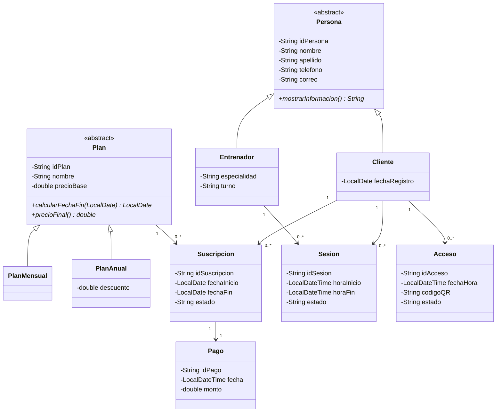
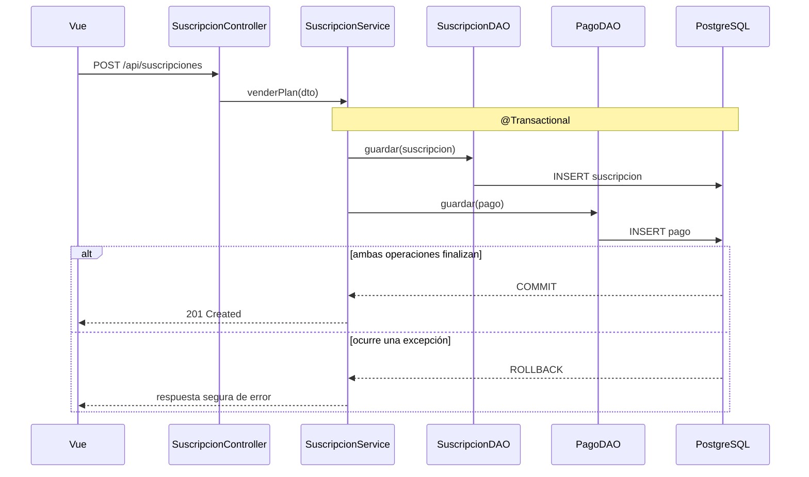

# Arquitectura y UML actualizado - Avance 3

Este archivo sirve como fuente versionable para los diagramas que deben
incorporarse al documento académico final.

## Componentes

Los controladores solo traducen HTTP; los servicios contienen reglas de
negocio; los DAO abstraen la persistencia; `DataSourceConfig` administra el
pool; y PostgreSQL conserva la integridad referencial y los traslapes.

## Modelo de dominio

## Flujo transaccional de una venta

## Decisiones de cohesión y acoplamiento

- Los servicios dependen de interfaces DAO.
- Los DAO dependen de `javax.sql.DataSource`, no del pool concreto.
- `JdbcEntityMapper<T>` separa el mapeo de filas del recorrido del `ResultSet`.
- `IdGenerator` y `TextoUtils` eliminan lógica duplicada entre servicios.
- `Clock` se inyecta para separar la hora del sistema de las reglas y pruebas.
